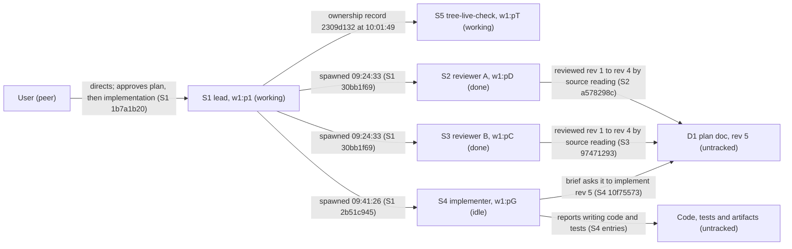

# Agent topology: observed roles and relationships

Snapshot: `herdr pane list` (read-only) at about 2026-11-02T10:05Z. Panes change state; re-run the list before relying on it. Edges are drawn only where a session, an ownership record or the pane list shows the relationship. Unknown actors are described in prose below the diagram, not drawn.

## Panes at the snapshot

"Session path" is the `agent_session` value herdr reports for the pane. That is a pane-to-session link from herdr; no session file records it, so the validator treats it as inferred.

| Pane | Session (short) | Role and evidence | State | Reviewed here |
|---|---|---|---|---|
| `w1:p1` | `01a19b53` (S1) | Lead: plans, delegates, relays. Model `gpt-6.1-terra` at session start (S1 `8e4f591a`). Working at 10:05Z | working | Partly (entries 369–414) |
| `w1:pT` | `01a19bb5-3538` (10:01:46Z; S5) | `tree-live-check`, in the lead's ownership record `2309d132` (10:01:49Z). Prompt submitted by lead at 10:01:49 (`6d769804`). Not in the metadata at the scan | working | No (metadata and validator only) |
| `w1:pG` | `01a19ba2-8a15` (S4) | Implementer. Named `tree-spike-build` (S1 ownership record `2b51c945`). Model `claude-haiku-5.5` (S4 `0a58ad17`). Reports it did not create `artifacts/native-tree-handoff/tui` (lead read `4436f807`) | idle | Partly (earlier reads) |
| `w1:pD` | `01a19b93-16e5` (S2) | Reviewer A, read-only. Named `native-rethink` (S1 `30bb1f69`). Model `claude-haiku-5.5` (S2 `3917b31d`). Prompted by lead at 09:58 and 10:01; state `done` at 10:05Z | done | Text only (earlier reads) |
| `w1:pC` | `01a19b93-16f9` (S3) | Reviewer B, read-only. Named `tree-review` (`30bb1f69`). Model `claude-haiku-5.5` (S3 `f103fdfa`). Prompted by lead at 09:58 and 10:01; state `done` at 10:05Z | done | Partly (earlier reads) |
| `w1:pF` | `01a19ba1-408f` (09:39:58 session; not one of S1–S6) | Unknown role. D4 names this session as the origin of the methodology. Not linked to a pane in metadata | working | No |
| `w1:pV` | none reported by herdr | Unknown. Focused pane, same cwd | working | No |
| `w1:pW` | `01a19bb8-1bab` (10:04:56Z; S6) | Unknown owner; not in the lead's ownership records read. Unrecorded in metadata at the scan | working | No (validator only) |

Not in the snapshot:
- `w1:p9`: the user's pane for the 09:13 test (S1 `4946ab81`). Reviewer A reported it missing at 09:44 (S2 `ab7dce86`). Still absent at 10:05Z.
- `w1:pA` `tree-handoff`, `w1:pB` `tree-cache` (S1 `222c8316`), `w1:pE` `tree-plan-editor` (S1 `ef24f1ed`) and `w1:pM` `progress-map-writer` (metadata) are absent. `w1:pM` was present at 09:54Z.
- Metadata-listed panes `w1:pH`, `w1:pJ`, `w1:pK`, `w1:pN`, `w1:pP`, `w1:pQ`, `w1:pR` are absent. They are closed or not visible; not verified.

## Topology

*Text fallback:* the user directs the lead. The lead spawned reviewers A (`w1:pD`) and B (`w1:pC`) at 09:24:33, and the implementer (`w1:pG`) at 09:41:26. The lead's ownership record at 10:01:49 also names `w1:pT` (`tree-live-check`). Reviewers A and B reviewed rev 1 to rev 4 by source reading. The implementer's brief asks it to build rev 5, and it reports writing the untracked code and tests. Pane `w1:pT` is working, its role is not read, and its link to the code is unknown. Both reviewers are now `done`; the lead has re-prompted them (reported).

## Not drawn: unknown actors and links (prose only)

- **Panes `w1:pF`, `w1:pV` and `w1:pW`** are working, with unknown roles. `pF` is the session D4 names as the methodology origin; `pW`'s session was created at 10:04:56Z. Whether any of them touches D1 or the code is unknown.
- **Cross-review prompts.** S2 `83d099c8` and S3 `b36a3767` are user-role messages that forward other reviewers' findings to a reviewer. The sender is not identified. *Hypothesis:* the lead.
- **Lead's live check.** The lead's entry `93d43e79` (10:04:05) says it started an isolated interactive check. *Hypothesis:* `w1:pT` is that check. Not verified; the lead's ownership record names `pT` `tree-live-check`, and its content is not read.
- **Session-to-pane mapping** for the 09:17 and 09:41 sessions in [sources.md](sources.md) remains hypothesis only, except where an ownership record or the pane list names the pane.

## What this map does not show

- Reviewer-to-pane identity is confirmed by the `agent_session` paths of the pane list for S2 (`w1:pD`) and S3 (`w1:pC`). The plan's review-status lines name the panes but not the sessions.
- No edge between reviewer A and reviewer B. Their findings reached each other only through the lead or the user, as seen in prompts.
- Pane lifecycle after the snapshot is unverified. The pane list can change within minutes.
