# History: how the native tree retirement work developed

Checked through 2026-11-02 10:05Z. Source IDs are defined in [sources.md](sources.md). Entry IDs are session JSONL entries (session `S1`, the lead, unless marked). Entries after 09:54Z are the lead's reports unless stated; I verified that each cited entry exists with the stated timestamp, not that its claims are true.

## Flow

```mermaid
flowchart TD
  A["08:21 User: /retire should work like /tree, same caching"] --> B["09:04 User: meter did not visibly change; agent: cache-friendly, savings not shown"]
  B --> C["09:13 Test in pane w1:p9: 16.1% to 17.0%, receipt created (reported)"]
  C --> D["09:16 User: use native /tree as transport and back-in-history strategy"]
  D --> E["09:21 Agent: overlay may silently fail on Pi 1.4.0 (unverified)"]
  E --> F["09:23 Agent: native navigation with agent handoff as branch summary; user: no hacks"]
  F --> G["09:24 to 09:31 Two reviewers; lead withdraws one-command flow"]
  G --> H["09:31 User: persist plan, get review, then implement and live-verify with pi -ne -e index.ts"]
  H --> I["09:34 to 09:40 Plan rev 1 to rev 4 reviewed; rev 4 'no blocker to bounded spike'"]
  I --> J["09:41 Plan rev 5; implementer starts bounded spike"]
  J --> K["09:49 to 09:53 Harness tests reported passing on 0.99.1 faux provider"]
  K --> L["09:58 Lead reports prototype tests and live print-mode handoff (reported, not TUI or payload)"]
  L --> M["10:01 Lead reports concurrency blocker: overlapping commands share pending state (reported)"]
  M --> N["10:04 Lead reports overlap guard and tests; isolated interactive check started (reported)"]
  N --> O["10:08 Lead reports TUI handoff, request payload and reload; old branch and footer still being checked"]
```

*Text fallback:* the user moved the work from a `/retire` overlay test (09:13, reported) to native `/tree` as transport (09:16). Reviewers found hook-override and fallback risks, so the lead dropped its one-command flow. A plan (rev 1 to rev 4) was reviewed and led to a bounded spike (rev 5, 09:41). Harness tests were reported as passing on the 0.99.1 SDK (09:49–09:53). At 09:58 the lead reported a live print-mode handoff, and not TUI or request-payload checks. At 10:01 it reported a concurrency blocker, and at 10:04 an overlap guard with tests and an isolated interactive check started. None of these lead reports is independently verified here, At 10:08 the lead reported the TUI handoff, captured request and reload; old-branch and footer checks remained open. These reports and the rev 5 review still need independent assessment.

## Sequence with sources

1. **08:21** User: `/retire` should behave like `/tree`, using the same mechanism and caching; the agent defines the summary (`9199a1c2`).
2. **09:04** User cannot see the context meter change after `/retire` (`8fe4e50a`). Agent: cache-friendly by design, savings not shown (`a5ee3581`).
3. **09:13** Test in pane `w1:p9`: 16.1% before, 17.0% after, receipt created. Agent: not a controlled measurement; does not show the reduced context reached the model (`0c2f3471`). *Reported.*
4. **09:15** `/tree` navigation returns the meter to 16.1%. Agent: the footer may show an earlier usage record (`61138ee4`). *Reported.*
5. **09:16** User: use Pi's native `/tree` as transport and for back-in-history strategy (`273dcc42`).
6. **09:21** Agent: the existing overlay may silently fail on Pi 1.4.0 (`f646b32f`). *Unverified.*
7. **09:23** Agent recommends native tree navigation with the agent's handoff as branch summary. It names a semantic change: current work leaves the active branch (`e5453b86`). User: honest, first-class solution, no hacks (`e1188865`).
8. **09:24** Two read-only reviewers launched: `w1:pD` (S2 `6181d535`) and `w1:pC` (S3 `5b16671d`).
9. **09:31** Lead withdraws its one-command flow (`85255889`). Reviewers report that another hook can override the summary and that a failed hook can fall back to Pi's default summarizer (S2 `31901a44`; S3 `bb226eef`).
10. **09:31** User: once the plan is sound, persist it, get it reviewed, then implement and live-verify with `pi -ne -e index.ts`. Runtime proof over theory (`1b7a1b20`).
11. **09:34 to 09:40** Plan rev 1 to rev 4 reviewed. Rev 4 gets "no blocker to a bounded spike" from both reviewers, based on source reading (S2 `a578298c`; S3 `97471293`).
12. **09:41** Plan rev 5 exists. Lead starts the bounded implementation (`5ec865ad`). Implementer `w1:pG` launched (`2b51c945`); brief in S4 `10f75573`.
13. **09:49 to 09:53** Implementer reports harness tests on the 0.99.1 SDK with a faux provider: 19 tests with 2 failing at 09:51:07 (S4 `3896d98c`), then 20 passing (`f807ceef`), 23 passing (`f1f2897c`), 20 passing (`17358c73`). *Reported. I did not run them.*
14. **09:55 to 09:58** (lead's reads of pane `w1:pG`, reported). The implementer runs a print-mode check with `pi -p -ne -nc -e ./index.ts --session-dir artifacts/native-tree-handoff/live`. Its console, quoted in the lead's tool result (`80da55e3`, 09:58:05, truncated), says the resumed model answered `zebra-7`. *Reported. I did not read the console or the artifacts.*
15. **09:58:23** Lead (`fa48c1dc`): the prototype passed its current automated tests and a live **print-mode** handoff, including a follow-up that recovered a marker from the new branch summary. Not yet the requested TUI or direct request-payload verification. *Reported.*
16. **10:00:39 to 10:00:43** Reviewer `w1:pC` (S3) console, read by the lead (`29b48a8c`, `ab4f9a5d`): it could not run a reproduction because the session was in read-only discuss mode; its concurrency analysis is static and labelled as such. *Reported, static only.*
17. **10:01:05** Lead context compaction (`d9c804a8`). Its summary is not checked here; this map relies on the entries.
18. **10:01:13** Lead (`04571171`): review found a significant concurrency gap: overlapping commands can share and clear the pending handoff state. Source-supported, not reproduced. The lead treats it as a blocker and tightens the implementation before the TUI test. *Reported.*
19. **10:01:17** Reviewer `w1:pD` console, read by the lead (`fecd41bd`): the `finally` block (line 606) clears pending state regardless of ownership, and nothing re-validates pending state at the later check (line 579). *Reported. Matches the lead's description; not verified here.*
20. **10:01:46 and 10:01:49** New session `01a19bb5…` created (10:01:46.553Z). The lead records `w1:pT` as `tree-live-check` in its ownership entry `2309d132` (10:01:49.793Z) and submits a prompt to it (`6d769804`). Whether pT is the isolated check is *hypothesis*. Its content is not read.
21. **10:03:57** Lead reads pane `w1:pG` (`4436f807`). `pG` states that it did not create `artifacts/native-tree-handoff/tui` or `agent/scripts/inventory_work_sessions.py` and flags them as someone else's work. *Reported (pG's statement).*
22. **10:04:01 to 10:04:05** Lead (`93d43e79`): the overlap guard is in place, with tests that deliberately pause one command and reject a second. No pass counts are stated. The isolated interactive check is started, and reviewers are checking the final implementation rather than only the plan. *Reported.*
23. **10:04:56** Session `01a19bb8…` created, pane `w1:pW`. Owner and content not checked. Listed as an unrecorded candidate in the validator run at ~10:05Z.
24. **Not in the sources read:** the TUI check, a direct request-payload capture, reviewers' verdicts on the final code, and any rev 5 review.

## Notes

- The plan's status line is stale. D1 "Review status" still says "Implementation: not started" and "re-review of rev. 5 pending" (D1, section "Review status"). The hash of D1 has not changed since 09:51Z (`7bdec5dc…`), so the stale line is still in the file. The implementer started at 09:41.
- The reviewer approvals (step 11) are for rev 4. No session I read reports a rev 5 review.
- Step 14 corrects an earlier note in this map that said no live run was reported. A print-mode run is reported at 09:58; it does not cover the TUI or the request payload.
