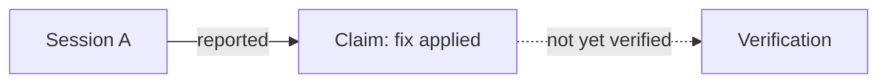

# Grounded Progress Map

**Working name · Idea and requirements draft** — not yet a tested method. One instance is live: [`2026-11-02-native-tree-retirement`](grounded-agent-work-map/2026-11-02-native-tree-retirement/README.md). It has a session inventory and one validator script, so the method is in use but still not established.

## Purpose

Give a human a quick, understandable picture of **what happened, what is happening, and how the important pieces connect**—without needing to read every agent session. Make the picture easy to update from the last checked point and easy to question against its sources. Keep it simple and transferable to other projects.

## Expectations

- Capture the important steps, findings, decisions, relationships, and open questions across agents; do not reproduce the transcripts.
- Put the human-readable overview first. Agents do the collection and synthesis initially.
- Ground information in traceable sources so a human or agent can cross-check and rethink it when new information appears. Distinguish what a source reports from what has actually been independently verified.
- Update incrementally from explicit checkpoints, while reconsidering affected conclusions in light of both old and new sources. Show uncertainty, conflicts, corrections, and gaps instead of smoothing them over.
- Use Markdown-embedded Mermaid diagrams where a relationship, timeline, or topology is clearer as a picture, and always add a concise plain-text fallback so the map stays readable without rendering.
- Split the map by aspect (for example history, current state, agent topology, decisions, open questions, sources) instead of one long document, so each part can be read and updated on its own.
- Keep one instance of the map in its own directory, so related files stay together. The directory layout below is an example, not a mandated universal path.
- Start with a simple agent-led practice; do not assume automation or a particular storage system.

**Origin:** User requests in the local session `~/.pi/profiles/minimal/agent/sessions/--Users-christian.gintenreiter-dev-external-pi-smart-compact--/2026-11-02T09-39-58-735Z_01a19ba1-408f-762d-9bc5-65f34d8c9aad.jsonl`, entries `9ed05372`, `7c4b457a`, `be852233`, `bd4ce89a`, `e52d7de7`, and `8a4d2923` (2026-11-02 UTC). Entry `c536aee0` is an identical duplicate of `8a4d2923`. This is an environment-specific source pointer, not a portable link.

## Captured user requirements and aspirations

Traceable record of what the user asked for. Wording is paraphrased unless quoted; the entry ID is the source. The Expectations above summarize this list.

**Requirements** (stated as needed):

- **R1** Act as the persistent recorder of the most important steps, findings, and relations from all agents within this herdr-space. (`9ed05372`)
- **R2** Starting scope: the Pi sessions under `~/.pi/profiles/minimal/agent/sessions/--Users-christian.gintenreiter-dev-external-pi-smart-compact--/` from today. (`9ed05372`)
- **R3** Smart, human-friendly representation so a human can quickly grasp the main aspects of what happened and what is happening. Keep it simple; start with agents doing the work. (`7c4b457a`)
- **R4** Updatable from the last checked point. (`7c4b457a`)
- **R5** Verifiable, grounded provenance, so information can be cross-checked and rethought from all sources when new information is added. (`7c4b457a`)
- **R6** Write these expectations into a separate Markdown file to track the idea, and give the methodology a name for transfer to other projects and tasks. (`7c4b457a`; working name is in the title)
- **R7** Use Mermaid diagrams embedded in Markdown. (`bd4ce89a`)
- **R8** Split the information by aspect (for example history, current-state, agent-topology), not one large document. (`bd4ce89a`)
- **R9** Create an instance that represents the current ongoing work. (`be852233`)
- **R10** Record all of these requirements in this document, without losing nuances. (`8a4d2923`)

**Aspirations** (asked to think about or explore; not mandated):

- **A1** Represent an instance in a dated sub-directory such as `docs/grounded-agent-work-map/<date>-<instance-short-name>/`, so structuring becomes natural. (`bd4ce89a`)
- **A2** Script some parts of the work. (`e52d7de7`)
- **A3** A `metadata.json` that records agent-session-file identifiers, at least the stable ones, and ideally every participating Pi session, so the full history can be gathered and cross-checked. (`e52d7de7`)
- **A4** Smart detection of participating sessions, for example a starting message with clear parts that also appears in another agent when delegating. The user offered this as a humble first approach and expects better methods. (`e52d7de7`)

### Proposed implementation (agent proposal, not a user requirement)

- The aspect files and directory layout below are a proposal for R8 and A1.
- The first instance has a `metadata.json` (schema `pi-smart-compact/grounded-agent-work-map/session-inventory`, version 1.0.0) and a validator script, `agent/scripts/inventory_work_sessions.py`. A general format is still open. The instance's fields are session path and identifiers, role, pane link with a verification level, first-user-message hash, evidence entries, and unlisted candidates. The user's nuance (`e52d7de7`) still applies: record at least the stable identifiers, and ideally every participating session.
- Prompt-text overlap (A4) is a clue that two sessions may be related. It is not proof of participation, delegation, or who did the work.

### Inclusion certainty and limits

- Known: the entries above were read directly from the session JSONL. Their text is the user's words.
- Partly addressed by the first instance: its `metadata.json` lists 22 sessions and 3 unlisted candidates. Discovery is not claimed complete, and pane-to-session links are inferred. Which sessions belong to the herdr-space is still not established; participants may live elsewhere.
- Unverified: whether a session file's identifier stays stable across branching, editing, or moving. Check this before relying on it in `metadata.json`.
- A metadata file or text match can miss participants. Treat its contents as a candidate list until each entry is checked against its source.
- This section records the user's words and open ideas. It does not show that the method works. The instance's validator checks its metadata against the session files; it does not prove completeness.

## Proposed starting practice

1. **Find and scope sources.** List the relevant agent sessions, documents, and other evidence; note sources not yet inspected. Agent reports are useful leads and evidence of what was reported, but do not by themselves prove their underlying claims.
2. **Make a short map.** Lead with the current picture, then the main developments and their connections, decisions, open questions, and next actions. Link each material claim to the specific source location; identify reported, verified, uncertain, or conflicting information in plain language.
3. **Record checkpoints.** For each source, record what was checked: for example, a session path and last inspected entry ID and timestamp, or a document path and checked revision or content hash. State the time and scope of the overview; a checkpoint is not a claim that every relevant source was found.
4. **Update and rethink.** Discover new sources and inspect additions since each checkpoint. Revisit related earlier claims against relevant sources, retain important corrections and their provenance, and only then advance the affected checkpoints. If a source was edited, rewritten, branched, or its checkpoint is missing, reassess it rather than assuming an append-only delta is sufficient.

The overview is a navigation aid, not a substitute for the underlying evidence. A source may disappear or change; record that limitation rather than claiming it remains verifiable.

## Illustrative map shape

```markdown
# Topic — checked through [time and scope]

## At a glance
[What happened, what is happening, and why it matters.]

## Key developments and connections
- [Claim and its status; exact source location.]
- [Decision, who made it, and its relationship to another finding; sources.]

## Open questions and next actions
- [What remains uncertain, what could settle it, and who acts next if known.]

## Sources and checkpoints
- [Session path + last inspected entry ID/time; limitations.]
- [Document path + revision or content hash; limitations.]
```

This shape is illustrative, not evidence that a map already exists or works.

## Proposed directory layout (example)

One instance of the map (a topic, project phase, or agent group) gets one directory named `<date>-<instance-short-name>`. Each aspect is one Markdown file; `README.md` is the entry point and links to the rest. File names are a proposal and remain open.

```text
docs/grounded-agent-work-map/
  2026-11-02-<instance-short-name>/
    README.md          # at a glance; checked-through time and scope; links to aspect files
    history.md         # timeline of developments, each with its source location
    current-state.md   # present picture with reported / verified / uncertain labels
    agent-topology.md  # agents, roles, and how they relate (Mermaid + text fallback)
    decisions.md       # decisions, who made them, and what they relate to
    open-questions.md  # uncertainties, what could settle them, next actions
    sources.md         # source paths, checkpoints (entry ID/time or hash), limitations
```

The method stays the same if a project uses other names or no directory at all; only the example path is project-specific. The first instance departs from the example: it has `metadata.json` and no `decisions.md` or `open-questions.md` (decisions and open questions are in `current-state.md`).

## Diagrams with plain-text fallback

Diagrams are embedded as Mermaid code blocks directly in the Markdown file, not as separate image files. Directly under each diagram, give a short plain-text summary of the same content, so a reader or agent without a Mermaid renderer loses nothing essential.

````markdown


*Text fallback:* Session A reports that a fix was applied; that claim is not yet independently verified.
````

This example is illustrative only and does not show a working map.

## Questions to develop

- What is the smallest useful map and checkpoint format for a real project?
- Where should it live alongside existing documentation, without creating a competing knowledge base?
- How should corrections, conflicting sources, inaccessible sources, and incomplete coverage be represented?
- What should trigger a deeper re-check instead of an incremental update?
- Is one directory per instance with one file per aspect the right granularity, or does it fragment the picture too much for a small project?
- How can participating sessions be detected and listed in `metadata.json` with honest inclusion certainty, given that prompt-text overlap is only a clue?

**Next:** the first instance is live, and its status and checkpoints are in its README. Open method questions: the general metadata format; whether session identifiers stay stable across branching; and how to list candidate sessions without treating them as participants.
